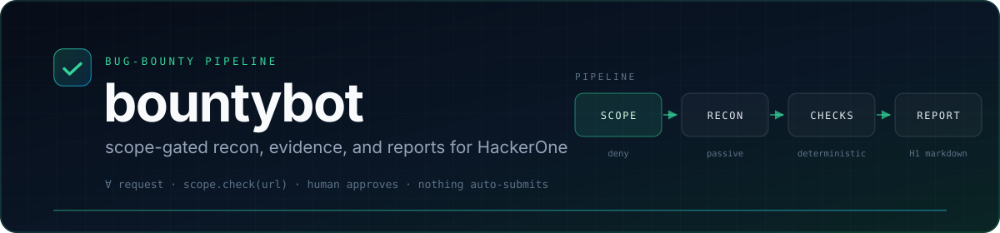
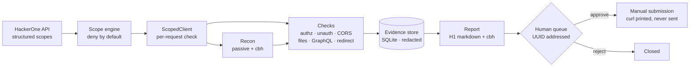

<div align="center">



<br>

[](https://github.com/webspoilt/bounty-hunter-/actions/workflows/tests.yml)


[](bb/scope.py)
[](bb/gate.py)


<em>A measurement instrument for authorization bugs.<br>
It sends only what the scope permits, proves only what two identities observed,<br>
and stops before submission.</em>

</div>

---

> **Abstract.** Automated bug-bounty tooling sits at two unsatisfactory extremes: scanners that
> fire indiscriminately, and LLM agents that narrate findings they cannot prove. This paper
> describes **bountybot**, a scope-gated measurement pipeline for authorization defects on
> HackerOne. The system makes three commitments. **(i)** Every outbound request is authorised by
> a deny-by-default predicate evaluated on the *fully resolved* URL, so path confusion, userinfo
> spoofing, and redirects cannot escape the declared program scope. **(ii)** An authorization
> claim requires a differential observation: the same object requested by two identities, where
> the owner's identity appears in the non-owner's response and the non-owner's identity does
> not. **(iii)** Reports are generated from redacted evidence and are never submitted
> automatically. On an instrumented OWASP Juice Shop lab, 10/10 adversarial scope-bypass inputs
> are refused, a 53-request hunt recovers a high-confidence cross-account IDOR in 11.8 s, the
> generated report passes an independent seven-question triage gate, and 107 tests run in ≈5 s
> without network access. Beyond stateless replay, an authenticated HAR seeds a real endpoint
> inventory, a declarative scenario runner tests create-as-A/cross-mutate-as-B flows, and outcome
> metrics connect findings to accepted reports.

**Keywords:** bug bounty · broken object-level authorization · scope enforcement · evidence
provenance · human-in-the-loop · local LLMs · HackerOne

---

## 1 · Introduction

A bug bounty is a *measurement problem* before it is an exploitation problem. The researcher
must decide, for each pair of identities and each object, whether the server returned data it
should not have. Done by hand this is slow; done carelessly it is either unsafe or dishonest.

Two failure modes dominate current automation:

1. **Unsafe automation.** Tools accept a URL and a wordlist and send traffic wherever the
   pipeline points them. Scope is a note in a README, not an invariant. A single
   protocol-relative path (`//evil.example/x`) can leave the program's assets while every log
   says "in scope".
2. **Unverifiable automation.** An LLM is asked to "find bugs", returns a plausible paragraph,
   and the operator cannot reconstruct which request produced which claim. Reports built on
   this collapse at triage.

bountybot is an attempt to make the opposite trade-offs explicit and testable. It treats scope
as a predicate, authorization as a differential measurement, and the report as a rendering of
stored evidence.

**Contributions.**

| | Contribution | Where |
|---|---|---|
| **C1** | A single HTTP choke point that evaluates scope on the resolved URL, records every allow/deny, and supports dry-run planning. | [`bb/http.py`](bb/http.py), [`bb/scope.py`](bb/scope.py) |
| **C2** | A conservative two-role decision rule for IDOR that separates *proven* cross-account access from *identical-but-unowned* candidates. | [`bb/checks.py`](bb/checks.py) |
| **C3** | Five further deterministic, read-only checks (unauthenticated access, CORS, exposed files, GraphQL introspection, open redirect) with signature matching to suppress status-code false positives. | [`bb/checks.py`](bb/checks.py) |
| **C4** | Evidence capture with redaction at write time, an SQLite provenance store, and H1-ready report rendering with an LLM guard and an independent triage gate. | [`bb/redact.py`](bb/redact.py), [`bb/store.py`](bb/store.py), [`bb/report.py`](bb/report.py) |
| **C5** | A UUID-addressed human approval queue with no code path that submits to a platform. | [`bb/gate.py`](bb/gate.py), [`bb/h1.py`](bb/h1.py) |
| **C6** | A vendored source-audit contract (Cloudflare, MIT): six phases, JSON schema, and the upstream Node validators, kept separate from dynamic HTTP evidence. | [`skills/security-audit/`](skills/security-audit), [`bb/audit.py`](bb/audit.py) |
| **C7** | An authenticated investigation loop: HAR traffic import, stateful two-role scenarios with explicit claims, and outcome metrics for acceptance, duplicates, and bounty per hour. | [`bb/har.py`](bb/har.py), [`bb/scenario.py`](bb/scenario.py), [`bb/metrics.py`](bb/metrics.py) |

## 2 · At a glance

| Property | Value |
|---|---|
| **Scope model** | Deny by default; wildcard/domain/URL/CIDR/IP; ports and path prefixes; explicit exclusions |
| **Authorization test** | Two accounts, same object, similarity + identity-presence rule |
| **Checks** | `authz`, `unauth`, `cors`, `exposed`, `graphql`, `open_redirect`, `headers` (informational) |
| **Evidence** | Every exchange stored redacted (headers, bodies), hashed, deduplicated per run |
| **Reporting** | Deterministic H1 markdown; optional local-LLM polish with strict validation |
| **Submission** | Manual. `bb submit` prints a curl payload and sends nothing |
| **Source audit** | Companion Cloudflare skill (vendored, MIT): six phases, schema + Node validators |
| **Investigation loop** | HAR import from authenticated browsing → stateful scenarios → outcome metrics |
| **Stack** | Python 3.11+, `httpx`, SQLite, optional Ollama, optional Claude-BugHunter |
| **Tests** | 107, no network, ≈5 s; CI on Python 3.11 and 3.12 |

## 3 · Safety model

### 3.1 Scope as a predicate

A program is a pair of rule sets $R_{\mathrm{in}}, R_{\mathrm{out}}$. A rule $r$ either matches a
resolved request URL $u$ — same host (and port, when specified), same path prefix for URL
rules, or containment for CIDR rules — or it does not. The scope predicate is

$$
\mathrm{in}(u) = \left(\exists r \in R_{\mathrm{in}} : r \models u\right) \wedge \neg\left(\exists r \in R_{\mathrm{out}} : r \models u\right)
$$

with two clarifications that matter in practice:

* a wildcard `*.example.com` matches **subdomains only**; the apex must be listed explicitly;
* `*` in the exclusion set means "nothing is in scope", not "ignore everything else".

The host is normalised before matching (lowercase, punycode, trailing dot removed), and inputs
that cannot be normalised unambiguously — percent-encoded hosts, backslashes, userinfo,
non-HTTP schemes — are refused rather than guessed at.

### 3.2 Invariants

| ID | Invariant | Enforced at |
|---|---|---|
| **I1** | $\forall u: \mathrm{sent}(u) \Rightarrow \mathrm{in}(u)$ | `ScopedClient.request` — the only caller of `httpx.send` |
| **I2** | $\forall f: \text{submitted}(f) \Rightarrow \text{approved by human}(f)$ | No submission function exists; `bb submit` prints a command |
| **I3** | Credentials are redacted *before* persistence | `redact_headers` / `redact_body` at capture |

The important design choice is that I1 holds on the **resolved** URL. `httpx` builds the request
first, then the scope engine inspects the URL that will actually go on the wire:

```python
req = self._client.build_request(method, url, ...)   # //evil.test/x -> http://evil.test/x
decision = self.scope.check(str(req.url))            # deny
if not decision.allowed:
    self.store.audit_scope(..., "DENY", decision.reason)
    raise ScopeViolation(...)
```

### 3.3 Adversarial evaluation of the predicate

Ten bypass attempts against a scope of `lab.test`, `*.lab.test`, `10.0.0.0/24`, plus four
legitimate controls. Measured, not asserted:

| Input | Class | Result |
|---|---|---|
| `http://evil.test/` | foreign host | **DENY** |
| `//evil.test/x` | protocol-relative | **DENY** |
| `http://lab.test@evil.test/` | userinfo spoof | **DENY** |
| `https://lab.test.evil.test/` | suffix lookalike | **DENY** |
| `https://evil-lab.test/` | prefix lookalike | **DENY** |
| `https://lab.test%2eevil.test/` | percent-encoded host | **DENY** |
| `ftp://lab.test/` | non-HTTP scheme | **DENY** |
| `javascript:alert(1)` | junk scheme | **DENY** |
| `http://[::1]/` | off-scope IPv6 | **DENY** |
| `http://0x7f.1/` | numeric-shorthand host | **DENY** |
| `https://lab.test./`, `https://LAB.TEST/`, `https://api.lab.test/x`, `http://10.0.0.7:8080/` | controls | **ALLOW** |

**10/10 attacks refused, 4/4 controls allowed.** The same predicate is exercised by
[`tests/test_scope.py`](tests/test_scope.py) and by the live client in
[`tests/test_http.py`](tests/test_http.py).

## 4 · Architecture



| Module | Responsibility |
|---|---|
| [`bb/scope.py`](bb/scope.py) | Rule parsing/normalisation, predicate, H1 `asset_identifier` mapping, fingerprint |
| [`bb/http.py`](bb/http.py) | Choke point: resolve → check → pace → retry → capture; dry-run |
| [`bb/session.py`](bb/session.py) | Per-account login, token extraction, identity markers |
| [`bb/recon.py`](bb/recon.py) | Entry HTML, robots, sitemaps, JS bundles, OpenAPI; guarded cbh delegation |
| [`bb/checks.py`](bb/checks.py) | Six finding checks + informational hygiene; ownership rule |
| [`bb/store.py`](bb/store.py) | Runs, assets, endpoints, exchanges, findings, queue, scope audit |
| [`bb/report.py`](bb/report.py) | Deterministic report, LLM polish guard, lint, cbh finding format |
| [`bb/gate.py`](bb/gate.py) [`bb/telegram.py`](bb/telegram.py) | Human queue; optional allow-listed Telegram review |
| [`bb/h1.py`](bb/h1.py) [`bb/artex.py`](bb/artex.py) | H1 scope import + manual submission payload; ARTEX evidence push |

Why one choke point rather than a shared helper: a helper can be bypassed by importing
`httpx` directly, and it was — in an earlier iteration a protocol-relative path escaped the
base URL because the check ran on the *input* target while the client resolved something else.
The current design makes the check structurally unavoidable.

## 5 · Method

### 5.1 Observation

Recon is passive by default: the entry document, `robots.txt`, `sitemap.xml`, HTML links/forms,
same-origin JavaScript bundles (string and `fetch()` extraction), and common OpenAPI locations.
Subdomain enumeration is delegated to [Claude-BugHunter](https://github.com/elementalsouls/Claude-BugHunter)
(`cbh recon`) **only when the scope contains a wildcard covering the target**, because that tool
probes every discovered subdomain. Otherwise the delegation is refused with a reason.

### 5.2 Differential authorization test

For an object endpoint $o$ and roles $A$ (owner) and $B$ (non-owner), let $A(o)$, $B(o)$ be the
response bodies, $\sigma$ a Jaccard similarity over JSON leaf values (or tokens), and
$i_A, i_B$ identity markers (email or JWT-derived id). With $\tau = 0.90$:

$$
F(o) = \left[\sigma(A(o), B(o)) \ge \tau\right] \wedge \left[i_A \in B(o)\right] \wedge \left[i_B \notin B(o)\right]
$$

A finding is emitted only when $F(o)$ holds. The negated terms are what turn a curiosity into a
claim:

| Observation | Interpretation | Action |
|---|---|---|
| $A$ 2xx, $B$ 401/403 | Enforcement working | coverage note, no finding |
| $B$ 2xx, $\sigma \ge .90$, $i_A \in B$, $i_B \notin B$ | **Proof of cross-account read** | high-confidence IDOR |
| $B$ 2xx, $\sigma \ge .90$, no owner marker | Could be public or shared data | medium candidate, "confirm ownership" |
| $B$ 2xx, $0.5 \le \sigma < .9$, partial owner data | Soft leak | low-confidence candidate |
| $A$ not 2xx | No baseline | skipped |

This distinction is deliberate: the Juice Shop demo yields **one high-confidence finding and
four medium candidates**, not five findings. Public product catalogs and shared configuration
produce identical bodies for every identity and must not be reported as IDOR.

### 5.3 Non-authorization checks

All are read-only and scope-gated.

| Check | Positive signal | Guard against false positives |
|---|---|---|
| `unauth` | anonymous body ≈ authenticated body, contains identity/PII | requires the authenticated baseline |
| `cors` | `ACAO` reflects a sent origin, or `*` with credentials | wildcard without credentials is ignored |
| `exposed` | 200 **and** content signature (`[core]`, `SECRET_KEY=`, `CREATE TABLE`, …) | generic HTML 200 is rejected |
| `graphql` | introspection returns `__schema` | schema-shaped JSON required |
| `open_redirect` | 3xx with attacker marker in `Location` | redirect is never followed |
| `headers` | missing CSP/HSTS/XCTO | informational only; never queued |

### 5.4 Evidence

Every exchange is captured as:

```json
{"method": "GET", "url": "https://app.example.com/api/Users/27", "status": 200,
 "request_headers": {"authorization": "[REDACTED]"},
 "response_body": "{\"email\": \"victim@example.com\", ...}",
 "duration_ms": 41, "at": "2026-10-24T12:12:51+00:00"}
```

Redaction is applied *before* the row is written: sensitive headers are replaced wholesale,
JSON values under secret-looking keys are masked, bearer tokens/JWTs are removed from text, and
sensitive query parameters are masked in the stored URL. Emails are deliberately preserved —
they are the proof of cross-account access — and every report is reviewed by a human before it
leaves the machine.

### 5.5 Report generation

Three layers, each able to fail without breaking the previous one:

1. **Deterministic template.** Title, severity, data classes, numbered steps, redacted raw HTTP
   for both roles, curl reproduction with token placeholders, impact, remediation, scope
   attestation (program, fingerprint, import timestamp), and an honest duplicate-check note.
2. **Local LLM polish (optional).** The model receives only the facts and precedent; its output
   is accepted only if all three sections are present, lengths are sane, and no placeholder
   text appears. Otherwise the deterministic text is kept.
3. **Independent triage.** The finding is rendered in cbh's format and run through the
   seven-question gate, which either passes it or names the question to fix.

### 5.6 Authenticated traffic import

Anonymous recon cannot see the endpoints that require a session. `bb import har` takes a HAR
export from your own authenticated browser and treats it as untrusted input: every URL is
scope-checked, credentials are redacted before persistence, binary bodies are skipped, and the
file is size- and entry-capped. Import records observations and an object inventory; it does not
replay them. Mutating requests from browsing are kept as evidence, but only GET/HEAD requests are
candidates for stateless replay.

### 5.7 Stateful scenarios

The highest-value authorization tests need a sequence. A scenario is an ordered list of
requests with two roles, variable extraction, and an explicit claim:

```json
{"name": "object-write-idor", "base_url": "https://app.example.com",
 "steps": [
   {"id": "create", "role": "A", "method": "POST", "path": "/api/items",
    "json": {"name": "bb-disposable"}, "extract": {"item_id": "$.id"}},
   {"id": "attack_write", "role": "B", "method": "PATCH",
    "path": "/api/items/${item_id}", "json": {"name": "${marker}"}},
   {"id": "owner_verify", "role": "A", "method": "GET", "path": "/api/items/${item_id}"}
 ],
 "claim": {"type": "idor_write", "mutate": "attack_write",
           "verify": "owner_verify", "marker": "${marker}"},
 "cleanup": [{"role": "A", "method": "DELETE", "path": "/api/items/${item_id}"}]}
```

Claims are deterministic:

| Claim | Confirmed when |
|---|---|
| `idor_read` | the attacker step returns 2xx, contains the owner's identity, and not the attacker's |
| `idor_write` | the mutation returns 2xx and the owner's later read observes the attacker's marker |

`idor_read` also accepts `owner_step`, the owner's own baseline request. Include it: without it
the report carries only the attacker's exchange and no owner-side proof for the triager. The
runner logs a warning when it is missing.

A denied attacker (`401/403/404`) yields **enforced** — coverage, not a finding. Anything else is
`inconclusive`; no report is produced. Every non-GET/HEAD step requires `--allow-write`; cleanup
runs only with that flag, only after the run, and only against resources the scenario created.
`--dry-run` resolves and plans the sequence without sending.

### 5.8 Outcomes and metrics

A finding that is never submitted, or submitted and rejected, is not a result. `bb outcome`
records the program's decision (`accepted`, `duplicate`, `informative`, `rejected`, `unknown`),
the bounty, minutes invested, and dates. `bb metrics` derives acceptance rate, duplicate rate,
bounty per hour, and breakdowns by class and program. Unknown outcomes stay unknown — they are
not silently counted as failures.

## 6 · Evaluation

**Setup.** Reference machine: Windows, Python 3.12.10, `httpx` 0.28.1, local Ollama
(`qwen2.5:3b-instruct`, `qwen2.5-coder:7b`, `nomic-embed-text`), OWASP Juice Shop in Docker.
This is a lab evaluation, not a benchmark against live programs; see §9.

| # | Experiment | Measurement | Result |
|---|---|---|---|
| **E1** | Unit/integration suite | 107 tests, no network | **107/107 pass**, 3.3–4.9 s |
| **E2** | Scope predicate, adversarial inputs | 10 attacks + 4 controls | **10/10 denied, 4/4 allowed** |
| **E3** | Dry-run planning | full hunt, zero packets | **29 requests planned, 0 sent** |
| **E4** | Lab hunt, two roles | Juice Shop, rate 6 req/s | **53 requests, 64 endpoints, 11.8 s** |
| **E5** | Findings from E4 | ownership rule (§5.2) | **1 high (proven), 4 medium (confirm)** |
| **E6** | Report gate | cbh 7-question triage | **PASS 7/7** |
| **E7** | Knowledge base retrieval | 1,422 chunks / 423 documents | top-1 relevant precedent, ≈8 s end-to-end (CPU) |
| **E8** | Report render, deterministic | no model | ≈1.1 s |
| **E9** | HAR import, authenticated capture | 52 browser requests | **44 endpoints** (2 id-bearing), 0 out-of-scope stored |
| **E10** | Live scenario, Juice Shop | two accounts, 4 requests | **confirmed** cross-account read, report queued |
| **E11** | Stateful write harness | mock lab: create → mutate → verify → cleanup | **confirmed** write-IDOR, cleanup observed |
| **E12** | Outcome metrics | synthetic accepted outcome (INR 500, 90 min) | acceptance 100%, **₹333.33/hour** |

**Discussion.** The high-confidence finding is the intended output: role A's own object was
returned to role B with A's email present and B's absent. The four medium findings are the
price of honesty — each is an endpoint returning identical content to two unrelated roles, which
is *consistent with* IDOR but also with public data; the tool says so rather than inflating the
count. E7 is the weak point of the local stack: a 16 MB JSON corpus plus CPU embedding costs
seconds per query, which motivates the ANN/indexing work in §11.

**Threats to validity.** (i) One lab target; no live-program evaluation was possible without
program credentials. (ii) The similarity threshold $\tau = 0.90$ is a design choice, not a
tuned parameter; sensitivity is untested. (iii) The LLM layer is evaluated qualitatively (does
it preserve facts and pass validation), not by blind review. (iv) Windows-only manual runs;
CI covers Linux on two Python versions. (v) E12 records a synthetic outcome to exercise the
metrics path; it is not a bounty, and none of these numbers are earnings.

## 7 · Usage

### 7.1 Sixty-second demonstration

```powershell
cd "E:\IDEAS\new idea\bountybot"
python -m venv .venv; .\.venv\Scripts\Activate.ps1
pip install -e ".[dev]"

bb integrations   # ollama · KB · cbh · ARTEX · PentAGI · Juice Shop
bb demo
```

Expected (abridged):

```
run ... | program juice-shop-lab | scope ... | budget 5m @ 6 req/s
  [login] userA (...) id=27
  [login] userB (...) id=28
  [authz] testing 5 object-shaped endpoints as userA vs userB
requests: 53   endpoints: 64   scope audit: {'ALLOW': 53}

[HIGH  ] IDOR  http://localhost:3000/api/Users/27
        Broken object-level authorization: userB reads userA's object
```

### 7.2 A real program

```powershell
$env:H1_USERNAME = "your-handle"
$env:H1_TOKEN    = "..."                    # hackerone.com/settings/api_token
bb scope import --program acme --from h1
bb scope show   --program acme

bb init                                                          # example files
Copy-Item data\example.accounts.json data\acme.accounts.json   # edit paths + emails
$env:BB_PASS_A = "..."; $env:BB_PASS_B = "..."

bb hunt --program acme --entry https://app.acme.com/ `
        --accounts data/acme.accounts.json `
        --budget 25 --rate 3 --llm `
        --template "/api/users/{a_id}" --template "/api/invoices/{a_id}"

bb queue
bb report --finding <id> --llm --cbh        # 7-question gate
bb decide <queue-id> --approve             # exports data/decided/<id>.md
bb submit --finding <id> --team acme       # prints curl + JSON; sends nothing
```

If the API cannot expose scope (public programs), import a file:

```json
{"program": "acme",
 "in_scope": ["*.acme.com", "api.acme.com"],
 "out_of_scope": ["staging.acme.com"]}
```

### 7.3 Commands

| Command | Purpose |
|---|---|
| `bb init` | data dirs + example scope/accounts |
| `bb integrations` | health of Ollama, KB, cbh, ARTEX, PentAGI, lab, Burp |
| `bb scope import\|show\|check` | scope lifecycle and ad-hoc verdicts |
| `bb recon --program P --entry URL [--cbh]` | passive surface inventory |
| `bb hunt --program P --entry URL [...]` | full loop; `--dry-run` plans, `--llm` polishes |
| `bb findings [--all] [--min-severity]` | stored results |
| `bb report --finding ID [--llm] [--cbh]` | render/refresh, gate, lint |
| `bb queue [--push]` / `bb decide ID --approve\|--reject` | human gate |
| `bb hypothesize --program P` | precedents + grounded leads |
| `bb kb stats\|query\|ingest` | corpus operations |
| `bb import har FILE --program P` | authenticated traffic → endpoint inventory |
| `bb scenario run --file F --program P --accounts A [--allow-write]` | stateful two-role scenario |
| `bb outcome ID --status …` / `bb outcome --list` | record the program's decision |
| `bb metrics [--program P]` | acceptance, duplicates, bounty per hour |
| `bb audit init\|validate\|skill\|ingest` | source-code audit contract (vendored Cloudflare skill) |
| `bb artex status\|push\|task` | dashboard bridge |
| `bb submit --finding ID --team H` | print-only submission payload |
| `bb telegram [--push-only]` | allow-listed review from a phone |

### 7.4 Accounts file

```json
{
  "base_url": "https://app.acme.com",
  "login": {
    "path": "/api/login",
    "body_keys": {"email": "email", "password": "password"},
    "token_field": "token",
    "register_path": "/api/register",
    "register_extra": {"passwordRepeat": "${password}"}
  },
  "accounts": [
    {"label": "A", "email": "you+alice@example.com", "password_env": "BB_PASS_A"},
    {"label": "B", "email": "you+bob@example.com",   "password_env": "BB_PASS_B"}
  ]
}
```

`identity` is optional; the tool uses the JWT `email`/`id` claim, then the login email.

### 7.5 The authenticated investigation loop

```powershell
# 1. browse the program while logged in, export HAR from DevTools, import it
bb import har ~\Downloads\app.har --program acme

# 2. test a discovered object endpoint statelessly (GET only)
bb hunt --program acme --entry https://app.acme.com/ `
        --accounts data\acme.accounts.json --endpoint "/api/users/42"

# 3. or run a stateful scenario: create as A, mutate as B, verify as A
bb scenario run --file examples\scenarios\idor-write.json `
        --program acme --accounts data\acme.accounts.json --allow-write

# 4. record what the program decided and read the scoreboard
bb outcome <finding-id> --status accepted --bounty 500 --currency USD --minutes 90
bb metrics
```

`--dry-run` on the scenario prints every planned request first. `bb import har` never replays
the capture; writes happen only in a scenario with `--allow-write`.

## 8 · Integrations

| Component | Role | Configuration |
|---|---|---|
| **Ollama** | report polish, hypotheses, embeddings | `OLLAMA_URL`, `BB_MODEL` (default `qwen2.5:3b-instruct-q4_K_M`) |
| **Claude-BugHunter** (`cbh`) | subdomain recon, 7-question gate | auto-detected at `../Claude-BugHunter`; `CBH_HOME` |
| **ARTEX** (`:8787`) | evidence dashboard: assets + captured traffic | `ARTEX_TOKEN` |
| **PentAGI** (`:8443`) | long autonomous runs, human-supervised | run separately; health-probed only |
| **Burp** (`:8080`) | route traffic through its history | `--proxy http://127.0.0.1:8080` |
| **Knowledge base** | disclosed-report precedent + duplicate check | `data/kb.json`, `bb kb ingest` |

Every integration is optional. Without Ollama the reports are deterministic; without cbh the
recon is passive; without ARTEX nothing changes.

### 8.1 Source-code audits (companion skill)

`bb hunt` measures a deployed target; it cannot see the code. When you can read the source
(your own service, an open-source program, a scope that includes a repository), the repo
vendors Cloudflare's [security-audit skill](https://github.com/cloudflare/security-audit-skill)
at commit `c1c8a8c1471079fb0e188eeaff69b8e8db6564a8` (MIT; see
[`skills/security-audit/NOTICE.md`](skills/security-audit/NOTICE.md)). It runs a six-phase,
coverage-led audit with independent verification and two machine-checkable artifacts:
`findings.json` (against `report-schema.json`) and `coverage-ledger.json`.

```powershell
bb audit skill                       # location, commit, phases, install command
bb audit init --repo ../service --out ~/audits/service --profile standard
#   give the skill to Claude Code / DSH, then ask it:
#   "security audit ../service output to ~/audits/service"
bb audit validate --findings ~/audits/service/findings.json `
                  --ledger   ~/audits/service/coverage-ledger.json
bb audit ingest                      # optional: methodology into the KB
```

`bb audit init` refuses to write inside the target — the skill's write-isolation rule — and
scaffolds `run-metadata.json`, `architecture.md`, and valid empty `findings.json` /
`coverage-ledger.json`. `bb audit validate` runs the vendored validators: the untouched CLI
on POSIX, and on Windows (where the CLI's `O_NOFOLLOW` hardening is unavailable) the same
exported schema interpreter.

The two evidence models are deliberately not merged: a `bb hunt` exchange cannot become a
Cloudflare `confirmed` record, because that verdict requires a source trace (`file:line`) and
independent source verification. Dynamic HTTP evidence stays in bb's report; source evidence
stays in the skill's run directory.

## 9 · Limitations and responsible use

* **Lab-only evidence.** The numbers in §6 come from Juice Shop. No live HackerOne program was
  tested during development (no program credentials); the H1 scope importer is covered by
  fixture tests, not a live call.
* **Read-only by default.** `bb hunt` sends GET/HEAD. Scenarios may create, mutate, or delete
  only with `--allow-write`; cleanup is limited to objects the scenario created. Use disposable
  accounts and resources — a write-IDOR test is still a write.
* **Scenarios are authored, not generated.** The runner proves what a scenario asserts; it does
  not invent the flow. HAR import supplies endpoints, not semantics.
* **Outcomes are self-reported.** Metrics reflect what you record; unknown stays unknown.
* **Two accounts required** for the authorization checks; one account gives infrastructure
  checks only.
* **Threshold, not ground truth.** $\tau = 0.90$ is conservative; medium candidates are
  explicitly labelled as requiring ownership confirmation.
* **LLM quality is not measured.** It is constrained, validated, and optional — not trusted.
* **You must be authorised.** The scope gate is a safety mechanism, not a permission slip. Test
  only programs whose policy allows it, respect rate limits, and read the program brief.

## 10 · Reproducibility

```bash
git clone https://github.com/webspoilt/bounty-hunter-.git
cd bounty-hunter-
python -m venv .venv && source .venv/bin/activate   # Windows: .venv\Scripts\activate
pip install -e ".[dev]"
python -m pytest -q          # 107 passed, no network
python -m bb integrations    # optional local stack
```

Repository map:

```
bb/            implementation (scope, http, checks, report, store, har, scenario, metrics, cli)
tests/         107 pytest cases: no network, MockTransport for HTTP
skills/        vendored Cloudflare security-audit skill (MIT): docs, schema, validators
examples/      scenario examples + the stateful format
assets/        banner
data/          runtime state (gitignored): DB, scopes, reports, KB
REVIEW.md      historical v1 review, kept for the record
.github/       CI: Python 3.11 + 3.12, Node for the audit validators
```

Reproducing the evaluation: start Juice Shop on `:3000`, then `bb demo`; the seeds are fixed
account emails and the tool registers them when absent. `--dry-run` reproduces E3 without
sending traffic.

## 11 · Future work

1. **Role and tenant transitions.** Invitations, org switches, ownership transfers, and
   downgrades are stateful flows the scenario format should model as first-class steps.
2. **HAR-to-scenario synthesis.** Infer create/read pairs from a captured session and propose
   scenarios for human review — not autonomous execution.
3. **Out-of-band checks.** Integrate an interactsh-style collector for blind SSRF/XXE without
   abandoning the scope predicate.
4. **Duplicate detection at import time.** Query H1 Hacktivity by asset and weakness to attach a
   real duplicate score instead of a corpus keyword check.
5. **Indexed retrieval.** Replace the 16 MB JSON cosine scan with an embedded vector index to cut
   E7 from seconds to milliseconds.
6. **Calibration.** Measure precision/recall of the $\tau$ rule on a labelled set of historical
   authz reports.
7. **Report evaluation.** Blind review of LLM-polished vs deterministic reports by triagers.
8. **Source/dynamic correlation.** Link a runtime observation to the source unit that produced
   it, so an audit's `confirmed` record and a `bb` exchange can cite each other without
   weakening either evidence bar.

## References

1. HackerOne. *API documentation* — programs, structured scopes, reports. <https://api.hackerone.com/>
2. OWASP. *WSTG — Testing for Insecure Direct Object References (IDOR)*. <https://owasp.org/www-project-web-security-testing-guide/>
3. OWASP. *Juice Shop* — deliberately vulnerable web application. <https://owasp.org/www-project-juice-shop/>
4. S. Sharma. *Claude-BugHunter* — skill bundle and deterministic `cbh` runner. <https://github.com/elementalsouls/Claude-BugHunter>
5. *ARTEX* — autonomous penetration-testing dashboard. <https://github.com/Autumn-27/ARTEX>
6. *PentAGI* — autonomous penetration-testing platform. <https://github.com/vxcontrol/pentagi>
7. Ollama. *Local LLM runtime*. <https://ollama.com/>
8. *httpx* — Python HTTP client. <https://www.python-httpx.org/>
9. Cloudflare. *security-audit-skill* — multi-phase source audit with machine-checkable
   findings. <https://github.com/cloudflare/security-audit-skill>
10. Cloudflare. *Build your own vulnerability harness*.
    <https://blog.cloudflare.com/build-your-own-vulnerability-harness>

## Citation

```bibtex
@software{bountybot2026,
  title  = {bountybot: a scope-gated measurement pipeline for authorization bugs},
  author = {Arukha, Biswajeet},
  year   = {2026},
  url    = {https://github.com/webspoilt/bounty-hunter-},
  note   = {Research prototype; nothing auto-submits}
}
```

<div align="center">
<sub>Scope first. Evidence second. Report third. Submission never automatic.</sub>
</div>
