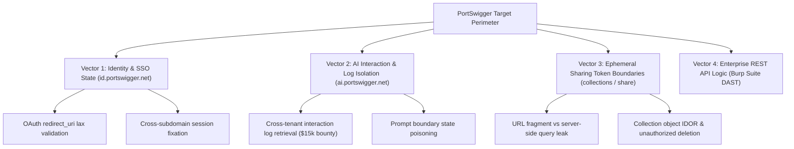
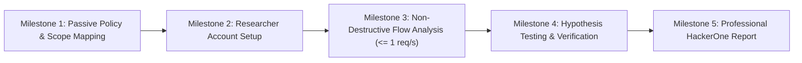

# FIRST TARGET RESEARCH PLAN: PORTSWIGGER WEB SECURITY
## Safe, Non-Destructive Vulnerability Research on an Open, Low-Saturation Target

---

### 1. Target Identity & Program Qualification Overview

- **Target Organization:** PortSwigger Web Security
- **HackerOne Program Handle:** `portswigger`
- **Program State:** `public_mode`
- **Submission State:** `open` (Verified active and receiving submissions)
- **Recent Activity Velocity:** **90 reports in the last 90 days** (~1 submission per day across the entire company surface)
- **Researcher Density:** **122 unique hackers thanked** (tight, non-crowded perimeter)
- **Response Efficiency:** **100%** (zero triage backlog)
- **Relative Saturation Classification:** **`LOW`**
- **Monetary Reward Tiers:**
  - **Critical:** **\$15,000**
  - **High:** **\$5,000**
  - **Medium:** **\$1,000**
  - **Low / Unlikely Interaction:** **\$100 – \$1,000**

---

### 2. Verified In-Scope Assets & Architecture

| Asset Identifier | Asset Type | Max Severity | Bounty Eligible | Operational Role & Technology Stack |
|---|---|---|---|---|
| **`id.portswigger.net`** | URL (Web/API) | **Critical** | **YES** | Central identity provider, authentication broker, and Single Sign-On (SSO) gateway for all PortSwigger cloud services. |
| **`ai.portswigger.net`** | URL (Web/API) | **Critical** | **YES** | AI assistant services, LLM prompt processing backend, and interaction log storage. |
| **`collections.portswigger.net`** | URL (Web/API) | **Critical** | **YES** | Ephemeral research sharing and vulnerability collection repository. Client-side URL fragment encryption. |
| **`links.portswigger.net`** | URL (Web/API) | **Critical** | **YES** | Dynamic link resolution and redirect infrastructure. |
| **`share.portswigger.net`** | URL (Web/API) | **Critical** | **YES** | Public and authenticated asset sharing mechanism. |
| **`portswigger.net`** | URL (Web/API) | **Critical** | **YES** | Main website, customer portal, license management, and order processing backend. |
| **`http1mustdie.com`** | URL (Web) | **High** | **YES** | HTTP/2 / HTTP/3 research and demonstration host (CloudFront CDN edge). |
| **`Burp Collaborator`** | Downloadable / Service | **Critical** | **YES** | OAST interaction server (custom private server testing required). |
| **`Burp Suite DAST`** | Web Application | **Critical** | **YES** | Burp Suite Enterprise Edition web application and REST API interface. |

---

### 3. Differential Research Strategy: Avoiding Crowded Ground

Because PortSwigger created Burp Suite, simple scanner-generated signatures (basic SQLi or reflected XSS on obvious query parameters) have already been thoroughly tested or blocked by CSP. 

Our research focuses specifically on **business logic, multi-tenant state isolation, and newly deployed modern infrastructure**:



#### Vector 1: Central Identity & Single Sign-On State (`id.portswigger.net`)
- **Hypothesis:** Central identity broker tokens may fail to enforce strict state parameter matching or allow subdomain redirection during the post-authentication callback.
- **Investigation Targets:**
  - OAuth 2.0 / OpenID Connect authorization code flow between `id.portswigger.net` and `portswigger.net`.
  - Session cookie scope (`Domain=.portswigger.net` vs host-only cookie isolation).
  - Password reset token consumption and concurrent session invalidation.

#### Vector 2: AI Interaction & Log Isolation (`ai.portswigger.net`)
- **Policy Context:** PortSwigger’s policy specifically rewards **\$15,000 for remotely retrieving arbitrary users' AI interaction logs with no user-interaction**.
- **Hypothesis:** Multi-tenant LLM interaction histories are mapped to user sessions via internal identifiers. If the retrieval API uses predictable identifiers or fails to validate session ownership, cross-tenant log disclosure is possible.
- **Investigation Targets:**
  - API endpoints handling chat session creation, history sync, and prompt submission.
  - Multi-tenant tenant ID parameter tampering in JSON payloads.

#### Vector 3: Ephemeral Collections & Sharing Infrastructure (`collections.portswigger.net`, `share.portswigger.net`)
- **Policy Context:** Collections are designed to be accessed via links where encryption keys are stored in URL fragments (`#key`). PortSwigger notes: *"Support for in-product deletion will be added in the future."*
- **Hypothesis:** Link resolution, metadata retrieval, or server-side logging may inadvertently ingest or mirror URL fragments into server-side logs or query strings, compromising end-to-end secret keys.
- **Investigation Targets:**
  - Server-side referrer headers or analytics endpoints on `links.portswigger.net`.
  - Access control on metadata endpoints before client-side decryption.

---

### 4. Policy Compliance, Safe Testing Protocols & Constraints

PortSwigger maintains a strict policy regarding researcher conduct. All research activities will enforce the following controls:

1. **Strict Request Rate Throttling:**
   - **Maximum 1 request per second** ($\le 1.0 \text{ req/s}$) across all tools.
   - All network traffic will route through Bounty Hunter’s `RateLimiter` set to $1000\text{ms}$ inter-request delay.
2. **Identification & Accountability:**
   - Custom HTTP header attached to all research requests:
     ```http
     User-Agent: Mozilla/5.0 (Windows NT 10.0; Win64; x64) BountyHunter/2.0 Research
     X-Bug-Bounty: hackerone-webspoilt-portswigger
     ```
3. **Explicitly Forbidden Actions (Program Rules):**
   - Denial of Service (DoS) attacks.
   - Physical or social engineering attacks against employees or customers.
   - Unthrottled automated scanning (Burp scans against `portswigger.net` will not be run).
   - Subdomain bruteforcing.
   - Theoretical prompt injection with zero security impact (prompts are not secret; only cross-user log leakage is in scope).
   - Volume spamming of orders, trials, or licenses.
4. **Researcher-Controlled Accounts Only:**
   - Testing will strictly use accounts registered and owned by the researcher (`webspoilt` research accounts).
   - No data belonging to any third party will be modified, viewed, or tampered with.

---

### 5. Research Execution Workflow & Milestone Checklist



- [x] Program qualified via authenticated HackerOne API audit (`submission_state: open`, cash tiers confirmed).
- [x] Relative saturation calculated as `LOW` (90 reports in 90 days; 122 thanked hackers).
- [ ] Manual researcher account creation on `id.portswigger.net` (manual in visible browser, complying with anti-bot rules).
- [ ] Passive capture and mapping of OAuth / SSO login exchange flows.
- [ ] Inspection of `ai.portswigger.net` API parameters for authorization token scoping.
- [ ] Multi-tenant IDOR verification using dual researcher accounts.
- [ ] Finding verification via independent validation before report generation.
