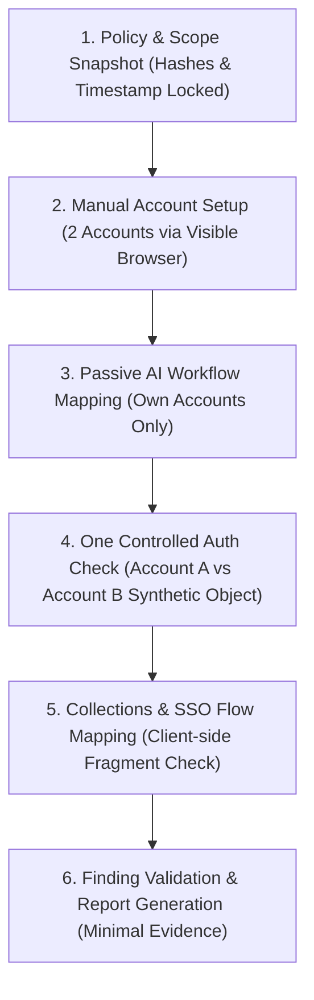

# FIRST TARGET RESEARCH PLAN: PORTSWIGGER WEB SECURITY
## Controlled, Non-Destructive Vulnerability Research on an Active Paying Program

---

### Program Status & Qualification Classification

**Official Status:**
`ACTIVE PAYING PROGRAM — LOWER RECENT INTAKE — COMPETITION NOT ESTABLISHED — MANUAL RESEARCH ONLY PENDING LIVE POLICY VERIFICATION`

- **HackerOne Program Handle:** `portswigger`
- **Program State:** `public_mode`
- **Submission State:** `open` (Verified active and receiving submissions)
- **Live Policy SHA-256:** `f6e6c87c227ccb8a042ec23b46d47369a599958d7506fdf698dc75349765a280`
- **Structured Scope SHA-256:** `9396a42d84d493dd2eeed157d5198914d1ad21500f4fc3d605479bbbb331e686`
- **Audit Timestamp:** 2026-11-17T04:39:41Z (Authenticated HackerOne REST API)

---

### 1. Competition Analysis & Telemetry Disclaimers

The evaluation of PortSwigger's competitive landscape separates rolling recent intake from lifetime platform metrics:

| Metric | Raw Value | What It Actually Establishes | What It Does NOT Prove |
|---|---|---|---|
| **Reports Received (Last 90 Days)** | **90 reports** | Recent incoming submission velocity (~1 report/day). Substantially lower intake than Basecamp (500) or GitLab (5,005). | Does not prove all 90 are unique researchers, nor does it guarantee low duplicate rates on obvious surfaces. |
| **Hackers Thanked (Lifetime)** | **122 hackers** | Cumulative lifetime count of researchers who have had at least one valid report resolved since program inception. | Does not indicate current active researcher volume (does not mean only 122 researchers are active today). |
| **Resolved Reports (Lifetime)** | **120 reports** | Total valid findings resolved and credited historically. | Does not indicate current open triage queue size. |
| **Response Efficiency** | **100%** | 100% of incoming reports met PortSwigger's internal SLA targets for first response and triage. | Does not mean zero backlog, instant final resolution, or guaranteed bounty payout for any specific report. |

**Classification Rationale:**
PortSwigger is favored over Basecamp because its recent intake is 82% lower (90 vs 500 reports in 90 days), and it maintains a 100% SLA efficiency rate. However, its overall researcher saturation cannot be proven as unconditionally "low" from public metrics alone; the perimeter must be treated as `COMPETITION NOT ESTABLISHED`. Testing must be selective, non-automated, and focused on novel functionality.

---

### 2. Complete Scope Inventory (10 In-Scope, 3 Out-of-Scope)

Direct extraction from the authenticated HackerOne API confirms the following asset boundaries:

#### 2.1 In-Scope Assets (10 Assets Total)

| # | Asset Identifier | Asset Type | Max Severity | Bounty Eligible | Asset Notes & Direct Policy Instructions |
|:---:|---|---|:---:|:---:|---|
| **1** | **`id.portswigger.net`** | URL | **Critical** | **YES** | Central identity provider, authentication broker, and Single Sign-On (SSO) gateway. |
| **2** | **`ai.portswigger.net`** | URL | **Critical** | **YES** | AI assistant services, LLM interaction backend, and prompt processing logs. |
| **3** | **`portswigger.net`** | URL | **Critical** | **YES** | Main website, customer portal, license management, and order processing backend. |
| **4** | **`collections.portswigger.net`** | URL | **Critical** | **YES** | Ephemeral research sharing and vulnerability collections. Uses URL fragment client-side key storage. |
| **5** | **`links.portswigger.net`** | URL | **Critical** | **YES** | Dynamic link resolution and redirection service. |
| **6** | **`share.portswigger.net`** | URL | **Critical** | **YES** | Public and authenticated asset sharing mechanism. |
| **7** | **`http1mustdie.com`** | URL | **High** | **YES** | HTTP/2 / HTTP/3 research host. *Instruction: Static content hosted using CloudFront.* |
| **8** | **`Burp Suite DAST`** | OTHER | **Critical** | **YES** | Burp Suite Enterprise Edition web application. *Instruction: Install from https://portswigger.net/burp/enterprise.* |
| **9** | **`Burp Collaborator`** | DOWNLOADABLE | **Critical** | **YES** | Out-of-band interaction server. *Instruction: Test only against private Collaborator instance.* |
| **10**| **`Burp Suite Pro/Community`**| DOWNLOADABLE | **High** | **YES** | Core desktop application. *Instruction: Download from https://portswigger.net/burp.* |

#### 2.2 Explicitly Out-of-Scope Assets (3 Assets Total)

| # | Asset Identifier | Asset Type | Boundary Restriction |
|:---:|---|---|---|
| **1** | **`*.portswigger.net`** | WILDCARD | **STRICTLY OUT OF SCOPE.** Having specific named subdomains in scope does **NOT** authorize testing sibling subdomains, wildcard DNS resolution, or arbitrary hosts under `portswigger.net`. |
| **2** | **`*.web-security-academy.net`** | WILDCARD | **STRICTLY OUT OF SCOPE.** Web Security Academy lab instances are intentionally vulnerable for learning and are excluded from rewards. |
| **3** | **`Burp Suite Extension (BApps)`**| DOWNLOADABLE | **STRICTLY OUT OF SCOPE.** Extensions in the BApp store are excluded unless authored directly by PortSwigger. |

---

### 3. Payout Evidence Trail: Three Delineated Tiers

To ensure complete accuracy regarding monetary rewards:

```
[Level 1: Confirmed Disclosures]     --> June 2026: $5,000 High | November 2026: $1,000 Medium
[Level 2: Published Reward Examples] --> Critical: $15,000 | High: $5,000 | Medium: $1,000
[Level 3: Live HackerOne Contract]   --> 10 in-scope assets confirmed eligible_for_bounty: True
```

1. **Confirmed Historical Cash Payments:**
   - Documented in publicly disclosed reports, including a \$5,000 High-severity award in June 2026 and a \$1,000 Medium-severity award in November 2026.
2. **Published Reward Examples (Policy Text):**
   - **Critical (\$15,000):** SQLi on `portswigger.net`, unauthenticated RCE on Burp Suite DAST, remote retrieval of arbitrary users' Burp Collaborator interactions, remote retrieval of arbitrary users' AI interaction logs with no user-interaction, complete authentication bypass.
   - **High (\$5,000):** Stored XSS on `portswigger.net` or Burp Suite Enterprise web UI, path traversal, untrusted project file RCE.
   - **Medium (\$1,000):** Local file retrieval via web context, cross-domain sitemap leakage, Collaborator key extraction, exploitable reflected XSS, critical CSRF.
   - **Medium with unlikely interaction (\$100 – \$1,000):** CSP bypass via trusted domain/JSONP, header injection, open redirect.
3. **Current Official Bounty Eligibility:**
   - Authenticated HackerOne API audit confirms `eligible_for_bounty: True` for all 10 listed in-scope assets.
   - *Disclaimer:* The \$15,000 maximum is a ceiling for critical impacts, not an expected average payout. Average bounty metrics are historical indicators, not guarantees.

---

### 4. Technical Correction of Research Hypotheses

#### 4.1 URL Fragment Handling on `collections.portswigger.net` (Corrected)
- **Technical Correction:** Per RFC 3986 and RFC 7230, the URI fragment component (`#key`) is evaluated strictly client-side by user agents and is **not transmitted** in the HTTP request line or standard HTTP Referer headers. It is technically invalid to claim that a `#fragment` key is automatically exposed to server-side access logs or reverse proxy logs during standard navigation.
- **Valid, Narrowed Hypothesis:** Testing will focus solely on whether the application's client-side JavaScript improperly copies fragment material into outgoing API payloads, telemetry events, query parameters, unencrypted localStorage/sessionStorage, or DOM sinks that leak cross-origin.

#### 4.2 AI Interaction Log Isolation on `ai.portswigger.net` (Tightly Bounded)
- **Technical Objective:** Test whether multi-tenant session binding prevents cross-tenant access to chat history or prompt logs.
- **Strict Bounded Protocol:**
  - Create two researcher-controlled accounts: **Account A** and **Account B**.
  - Generate a distinct synthetic prompt string from **Account B** (e.g., `SYNTHETIC_TEST_TOKEN_BH_2026`).
  - From **Account A**, attempt to reference Account B's specific interaction identifier through normal API parameters.
  - **Zero-Tolerance Third-Party Boundary:** Do NOT enumerate sequential IDs, do NOT perform brute-force ID guessing, and do NOT inspect any third-party records. If any unexpected data belonging to an unknown third party is returned, **stop testing immediately**.

#### 4.3 SSO & Identity Federation on `id.portswigger.net`
- **Methodology:** Map the exact OAuth 2.0 / OpenID Connect authorization code grant flow between `id.portswigger.net` and `portswigger.net` using only researcher-controlled accounts.
- **Guidance:** Do not treat standard cookie domain attributes (`Domain=.portswigger.net`) as vulnerabilities in isolation. Inspect redirect URI exact-matching, state parameter entropy, and session invalidation across subdomains.

---

### 5. Enforced Testing Controls & Central Rate Limiting

To comply strictly with PortSwigger’s program policy and prevent automated interference:

1. **Global Rate Limiting ($\le 1.0 \text{ req/s}$):**
   - The $\le 1$ req/s limit must be enforced **centrally and globally across all execution threads and processes**. Running multiple concurrent tools at 1 req/s each would violate the policy.
   - A single central token-bucket rate limiter will govern all outbound HTTP/HTTPS requests.
2. **Single Active Network Worker:**
   - Only one manual/scripted research session active at any time.
   - **Zero automated scanner runs:** Automated Nuclei, Burp active scanner, Dalfox, or Nikto scans are strictly prohibited on `portswigger.net`.
3. **Transparent Identification:**
   - HTTP requests will carry an honest, research-identifying User-Agent string:
     ```http
     User-Agent: Mozilla/5.0 (Windows NT 10.0; Win64; x64) BountyHunter-Research/2.0
     ```
   - *Note:* Do not attach unofficial headers like `X-Bug-Bounty` unless mandated by the live policy.

---

### 6. Prioritized 6-Step Research Sequence



1. **Step 1: Policy and Scope Snapshot**
   - Retain authenticated SHA-256 hashes (`Policy: f6e6c8...`, `Scope: 9396a4...`) and timestamp.
2. **Step 2: Manual Account Setup**
   - Manually register two researcher-owned accounts through a visible browser on `id.portswigger.net`. No automated account registration.
3. **Step 3: Passive AI Workflow Mapping**
   - Use standard UI features while proxying traffic in passive, read-only mode to map endpoints and token flows.
4. **Step 4: One Controlled Authorization Check**
   - Perform a single, targeted test: Account A requesting Account B's known synthetic object. Cease testing on the first confirmed unauthorized response.
5. **Step 5: Collections and SSO Flow Mapping**
   - Inspect client-side JavaScript for handling of fragment tokens on `collections.portswigger.net`. Map OAuth redirect handling.
6. **Step 6: Finding Validation & Professional Report**
   - Preserve minimal necessary evidence, redact all sensitive credentials, independently verify reproducibility, and prepare a concise HackerOne report draft.
