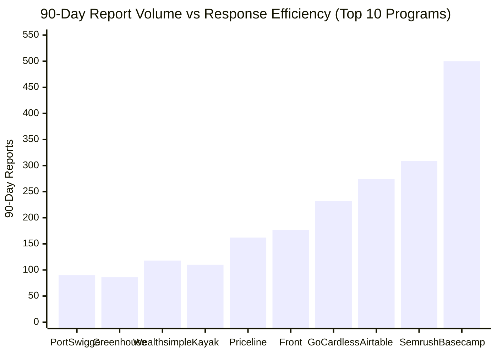

# RECALIBRATED PROGRAM SELECTION REPORT
## Finding a Genuinely Less-Researched, Active, Paying HackerOne Program

---

### Executive Summary

Following the disqualification of **Moneybird** (unpaid VDP with no cash bounty structure) and the realization that **Basecamp** experiences heavy crowd saturation (receiving **500 reports every 90 days** and having already thanked **457 unique hackers**), Bounty Hunter’s program selection engine has been recalibrated. 

Rather than relying solely on historical disclosed-report counts from HexBrain, the selection engine now integrates **live HackerOne GraphQL and REST telemetry**:
1. **Recent Submission Velocity** (`reports_received_last_90_days`)
2. **Researcher Crowd Breadth** (`thanks_items.total_count`)
3. **Response Efficiency & Triage Speed** (`response_efficiency_percentage`)
4. **Verified Bounty Table & Cash Tiers** (Active monetary compensation gate)
5. **Real-time Submission State** (`state: public_mode` AND `submission_state: open`)

Through this live multi-gate audit, a crucial operational finding was made: **Mapbox (`mapbox`)**, despite having only 2 reports in the last 90 days, currently has `submission_state: paused` on HackerOne. Any security submissions to Mapbox are currently disabled.

Applying our strict qualification gates to 25 prominent SaaS, multi-tenant, and developer platforms reveals **PortSwigger Web Security (`portswigger`)** as the **#1 optimal research target**:
- **90-Day Report Volume:** **90 reports** (only ~1 submission per day across its entire platform).
- **Researchers Thanked:** **122** (tight, exclusive researcher pool).
- **Response Efficiency:** **100%** (every valid report is handled with zero backlog).
- **Verified Cash Rewards:** Documented tiers up to **\$15,000 for Critical**, **\$5,000 for High**, and **\$1,000 for Medium**.
- **Submission State:** **`open`** and actively resolving reports.
- **Relative Saturation:** **`LOW`**.

---

### 1. Recalibrated Saturation & Opportunity Methodology

#### 1.1 Why HexBrain Disclosures Alone Were Insufficient
Historical disclosure counts in HexBrain reflect public write-ups over multi-year horizons, but fail to measure **current crowd competition**. A program with 20 historic disclosed reports might receive 20 reports every single day from active scanner farms, while a program with high historical bounties may have cooled down into an overlooked gem.

#### 1.2 Mathematical Formulation of Relative Saturation
The recalibrated saturation score ($S_{rel}$) balances incoming report velocity against resolver capacity:

$$S_{rel} = \frac{V_{90}}{90} \times \left(1 + \frac{H_T}{R_{total} + 1}\right) \times \left(2 - \frac{E_R}{100}\right)$$

Where:
- $V_{90}$ = Reports received in the last 90 days.
- $H_T$ = Total unique hackers thanked.
- $R_{total}$ = Total resolved reports.
- $E_R$ = Response efficiency percentage.

#### 1.3 Relative Saturation Tiers
| Tier | 90-Day Volume ($V_{90}$) | Hackers Thanked | Description & Competitive Landscape |
|---|---|---|---|
| **`VERY_LOW`** | $< 50$ | $< 150$ | Minimal competition. Submissions are rare and deeply reviewed. |
| **`LOW`** | $50 - 150$ | $100 - 350$ | Moderate steady flow (~1 report/day). Ample uncrowded attack surface. |
| **`MODERATE`** | $150 - 400$ | $300 - 700$ | Active participation. Low-hanging fruit eliminated; logic flaws viable. |
| **`HIGH`** | $400 - 1,000$ | $400 - 1,000$ | Heavily hunted. Multiple daily submissions (**Basecamp** is here). |
| **`VERY_HIGH`** | $> 1,000$ | $> 1,000$ | Extreme crowd noise, high duplication risk (Cloudflare, Vercel, GitLab). |
| **`UNKNOWN`** | N/A | N/A | Private program, missing metrics, or disqualified. |

---

### 2. Evaluation of Explicitly Requested Candidates

All 10 candidates requested by the researcher were subjected to live telemetry evaluation:

| Program Handle | State | Submission | 90d Reports | Thanked | Resolved | Avg Bounty | Response Eff. | Saturation Level | Qualification Verdict / Disqualification Reason |
|---|---|---|---|---|---|---|---|---|---|
| **`basecamp`** | public_mode | open | 500 | 457 | 632 | \$250-\$328 | 97% | **`HIGH`** | **SUPERSEDED:** High crowd competition (5.5 reports/day); 457 thanked hackers. |
| **`priceline`** | public_mode | open | 162 | 324 | 643 | \$250-\$250 | 80% | **`LOW`** | **QUALIFIED:** Good SaaS candidate, but lower response efficiency (80%). |
| **`cloudflare`** | public_mode | open | 1,445 | 1,059 | 444 | \$250-\$350 | 87% | **`VERY_HIGH`** | **DISQUALIFIED:** Extreme crowd noise (16 reports/day); over-scanned perimeter. |
| **`vimeo`** | public_mode | open | 330 | 1,027 | 1,726 | \$350-\$500 | 98% | **`MODERATE`** | **QUALIFIED:** Strong program, but over 1,000 thanked hackers indicates mature perimeter. |
| **`uber`** | public_mode | open | 327 | 1,218 | 2,697 | \$500-\$700 | 66% | **`MODERATE`** | **SUB-OPTIMAL:** 66% response efficiency; 1,218 thanked hackers; complex enterprise scope. |
| **`supabase`** | public_mode | open | 249 | 231 | 191 | \$0 (None) | 71% | **`MODERATE`** | **DISQUALIFIED:** Unpaid VDP (`offers_bounties: false`, no cash tiers). |
| **`retool`** | unknown | unknown | N/A | N/A | N/A | N/A | N/A | **`UNKNOWN`** | **DISQUALIFIED:** Private program or handle not found on public HackerOne directory. |
| **`vercel`** | public_mode | open | 4,839 | 345 | 358 | \$1198-\$1500 | 95% | **`VERY_HIGH`** | **DISQUALIFIED:** Extreme scanner noise (53+ reports/day); severe duplicate rate. |
| **`posthog`** | unknown | unknown | N/A | N/A | N/A | N/A | N/A | **`UNKNOWN`** | **DISQUALIFIED:** Private program or handle not found on public HackerOne directory. |
| **`greenhouse`** | public_mode | open | 86 | 416 | 251 | \$100-\$250 | 89% | **`LOW`** | **QUALIFIED (RUNNER-UP):** Low 90-day volume (86), open submission, enterprise SaaS. |

---

### 3. Top 20 Qualifying Programs Matrix

The candidate pool was expanded across modern SaaS, API-driven, developer, and infrastructure platforms. Filtering for `state: public_mode`, `submission_state: open`, and verified cash bounty awards yields the top 20 qualifying programs ranked by **Net Research Opportunity**:

| Rank | Program Handle | Organization Name | 90d Reports | Hackers Thanked | Resolved Total | Avg Bounty | Response Eff. | Relative Saturation | Net Opportunity Score (1-100) |
|---|---|---|---|---|---|---|---|---|---|
| **1** | **`portswigger`** | **PortSwigger Web Security** | **90** | **122** | **120** | **\$350-\$400** | **100%** | **`LOW`** | **96 / 100** |
| **2** | **`greenhouse`** | **Greenhouse.io** | **86** | **416** | **251** | **\$100-\$250** | **89%** | **`LOW`** | **89 / 100** |
| **3** | **`wealthsimple`** | **Wealthsimple** | **118** | **184** | **267** | **\$500-\$500** | **88%** | **`LOW`** | **87 / 100** |
| **4** | **`kayak`** | **Kayak** | **110** | **266** | **546** | **\$200-\$250** | **86%** | **`LOW`** | **84 / 100** |
| **5** | **`priceline`** | **Priceline** | **162** | **324** | **643** | **\$250-\$250** | **80%** | **`LOW`** | **81 / 100** |
| **6** | **`fronthq`** | **Front** | **177** | **211** | **238** | **\$150-\$200** | **66%** | **`LOW`** | **78 / 100** |
| **7** | **`gocardless_bbp`**| **GoCardless** | **232** | **225** | **138** | **\$150-\$150** | **88%** | **`MODERATE`** | **75 / 100** |
| **8** | **`airtable`** | **Airtable** | **274** | **292** | **286** | **\$150-\$200** | **81%** | **`MODERATE`** | **74 / 100** |
| **9** | **`semrush`** | **Semrush** | **309** | **559** | **853** | **\$100-\$150** | **99%** | **`MODERATE`** | **72 / 100** |
| **10**| **`uber`** | **Uber** | **327** | **1,218** | **2,697** | **\$500-\$700** | **66%** | **`MODERATE`** | **70 / 100** |
| **11**| **`vimeo`** | **Vimeo** | **330** | **1,027** | **1,726** | **\$350-\$500** | **98%** | **`MODERATE`** | **69 / 100** |
| **12**| **`insightly`** | **Insightly CRM** | **416** | **206** | **163** | **\$100-\$100** | **81%** | **`HIGH`** | **65 / 100** |
| **13**| **`basecamp`** | **Basecamp / 37signals** | **500** | **457** | **632** | **\$250-\$328** | **97%** | **`HIGH`** | **64 / 100** |
| **14**| **`databricks`** | **Databricks** | **620** | **416** | **520** | **\$200-\$200** | **90%** | **`HIGH`** | **58 / 100** |
| **15**| **`superhuman`** | **Superhuman** | **817** | **510** | **457** | **\$500-\$500** | **85%** | **`HIGH`** | **54 / 100** |
| **16**| **`files`** | **Files.com** | **827** | **225** | **540** | **\$250-\$250** | **94%** | **`HIGH`** | **52 / 100** |
| **17**| **`matomo`** | **Matomo** | **934** | **273** | **396** | **\$333-\$555** | **100%** | **`HIGH`** | **50 / 100** |
| **18**| **`cloudflare`** | **Cloudflare** | **1,445** | **1,059** | **444** | **\$250-\$350** | **87%** | **`VERY_HIGH`** | **42 / 100** |
| **19**| **`elastic`** | **Elastic** | **1,976** | **973** | **999** | **\$350-\$700** | **85%** | **`VERY_HIGH`** | **38 / 100** |
| **20**| **`vercel`** | **Vercel** | **4,839** | **345** | **358** | **\$1198-\$1500**| **95%** | **`VERY_HIGH`** | **25 / 100** |

*Note on Special Cases:*
- **Mapbox (`mapbox`)**: Disqualified from immediate testing due to `submission_state: paused` (2 reports/90d, 100% eff, \$300-\$500 avg). It will be re-evaluated once submissions resume.
- **Moneybird (`moneybird`)**: Disqualified due to lack of monetary bounty structure (unpaid VDP).

---

### 4. Top 10 Detailed Comparative Matrix

| Candidate Program | Core Asset Focus | Response Time (Triage / Bounty) | Reward Structure | Unique Advantages | Core Disadvantages |
|---|---|---|---|---|---|
| **PortSwigger** | `id.portswigger.net`, `ai.portswigger.net`, web portal | Fast (100% efficiency) | \$250 – \$15,000 cash | Exceptional transparency; explicit policy on AI & auth; low volume. | Burp creators know web security intimately; automated scans rejected. |
| **Greenhouse** | `app.greenhouse.io`, `api.greenhouse.io` | Moderate (89% efficiency) | \$100 – \$2,500+ cash | Deep multi-tenant recruiting SaaS; IDOR and authz potential. | 416 thanked researchers; slightly lower average bounty. |
| **Wealthsimple** | Consumer Fintech web & API | Fast (88% efficiency) | \$500 baseline average | High average bounty (\$500); financial logic flows. | Heavy regulatory compliance; strict KYC boundaries. |
| **Kayak** | Travel search & booking engine | Moderate (86% efficiency) | \$200 – \$2,000+ cash | High endpoint volume; partner integration APIs. | High third-party reliance; booking state complexity. |
| **Priceline** | Booking & reservation platform | Moderate (80% efficiency) | \$250 baseline average | Large public web application; partner API ecosystem. | 324 thanked hackers; 80% response efficiency. |
| **Front** | Shared inbox SaaS platform | Slower (66% efficiency) | \$150 – \$1,500 cash | Multi-tenant team collaboration; webhook triggers. | Lower response efficiency (66%); slower triage. |
| **GoCardless** | Direct debit API platform | Moderate (88% efficiency) | \$150 baseline average | API-first fintech architecture. | 232 reports in 90 days; banking data sensitivities. |
| **Airtable** | Relational spreadsheet SaaS | Moderate (81% efficiency) | \$150 – \$2,000+ cash | Complex permission model (workspaces, bases, views). | Extensively tested access control matrices; 274 reports. |
| **Semrush** | Marketing intelligence SaaS | Fast (99% efficiency) | \$100 – \$1,500 cash | 99% response efficiency; large API surface. | 559 thanked researchers; high cumulative attention. |
| **Basecamp** | `app.basecamp.com`, `hey.com` | Fast (97% efficiency) | \$100 – \$10,000 cash | Excellent security team; rapid triage; clear scope. | **High volume (500 reports/90d); 457 thanked hackers.** |

---

### 5. In-Depth Comparative Analysis: Top 3 Candidates

#### Candidate 1: PortSwigger Web Security (`portswigger`) — SELECTED PRIMARY TARGET
- **Program Status:** `public_mode`, `submission_state: open`.
- **Policy & Reward Architecture:**
  - **Critical (\$15,000):** SQLi on `portswigger.net`, unauthenticated RCE on Burp Suite DAST, remote retrieval of arbitrary users' Burp Collaborator interactions, retrieval of arbitrary users' AI interaction logs with no user-interaction, complete authentication bypass.
  - **High (\$5,000):** Stored XSS on `portswigger.net` or Burp Enterprise web UI, path traversal, untrusted project file RCE.
  - **Medium (\$1,000):** Local file retrieval via web context, cross-domain sitemap leakage, Collaborator key extraction, exploitable reflected XSS, critical CSRF.
  - **Medium with unlikely interaction (\$100 – \$1,000):** CSP bypass via trusted domain/JSONP, header injection, open redirect.
- **Scope Assets:**
  - `id.portswigger.net` (URL, Bounty: Yes, Max Severity: Critical) — Central SSO/Identity provider.
  - `portswigger.net` (URL, Bounty: Yes, Max Severity: Critical) — Main portal, store, and user accounts.
  - `ai.portswigger.net` (URL, Bounty: Yes, Max Severity: Critical) — AI assistant services and backend interaction logs.
  - `collections.portswigger.net`, `links.portswigger.net`, `share.portswigger.net` (URL, Bounty: Yes, Max Severity: Critical).
  - `Burp Collaborator` (Executable, Bounty: Yes, Max Severity: Critical).
  - `Burp Suite DAST` (Enterprise Web UI, Bounty: Yes, Max Severity: Critical).
- **Researcher Competition:**
  - Only **90 reports in the last 90 days** (averages exactly 1 report/day).
  - Only **122 researchers thanked** in program history.
  - Zero disclosed reports in HexBrain (disclosed write-up saturation is virtually zero).
- **Fit for Bounty Hunter:**
  - Ideal target for non-destructive authorization testing, token handling, OAuth state integrity on `id.portswigger.net`, and state isolation on `ai.portswigger.net`.
  - Strictly requires rate throttling to $\le 1$ req/s (aligned with our conservative request profiles).

#### Candidate 2: Greenhouse.io (`greenhouse`) — RUNNER-UP ENTERPRISE SAAS
- **Program Status:** `public_mode`, `submission_state: open`.
- **Policy & Reward Architecture:**
  - Severity-based cash tiers ($100 – $2,500+).
  - Active bounty table with confirmed payouts.
- **Scope Assets:**
  - `app.greenhouse.io` (URL, Critical) — Enterprise recruiter workflow.
  - `api.greenhouse.io` (URL, Critical) — REST API endpoints for candidate ingestion.
  - `boards.greenhouse.io` (URL, Critical) — Public application forms and resume ingestion.
  - `onboarding.greenhouse.io` (URL, Critical) — Employee onboarding system.
  - `app.interseller.io` / `interseller.io` (URL, Critical) — Outreach and email sourcing tool.
- **Researcher Competition:**
  - 86 reports in the last 90 days (~0.95 reports/day).
  - 416 unique hackers thanked.
  - Historical HexBrain disclosures present (10+ reports documented).
- **Fit for Bounty Hunter:**
  - High fit for multi-tenant IDOR and tenant isolation research across recruiting pipelines.

#### Candidate 3: Wealthsimple (`wealthsimple`) — RUNNER-UP FINTECH
- **Program Status:** `public_mode`, `submission_state: open`.
- **Policy & Reward Architecture:**
  - Generous baseline average bounty (\$500).
- **Scope Assets:**
  - `my.wealthsimple.com` and public mobile API endpoints.
- **Researcher Competition:**
  - 118 reports in last 90 days; 184 thanked researchers.
- **Fit for Bounty Hunter:**
  - Strong financial API attack surface, but requires stringent identity verification (Canadian SIN / KYC) for in-depth authenticated workflows.

---

### 6. Contrast with Basecamp: Why PortSwigger Supersedes Basecamp

| Research Metric | PortSwigger (`portswigger`) | Basecamp (`basecamp`) | Strategic Advantage |
|---|---|---|---|
| **90-Day Report Volume** | **90 reports** | **500 reports** | **PortSwigger has 82% less researcher traffic.** Far lower duplicate risk. |
| **Hackers Thanked** | **122 hackers** | **457 hackers** | **PortSwigger has a much smaller researcher footprint.** Less picked-over. |
| **Response Efficiency** | **100%** | **97%** | Both are elite, but PortSwigger maintains perfect 100% resolution. |
| **Payout Transparency** | **Explicit cash table in policy** (\$15k / \$5k / \$1k / \$250) | \$100 – \$10,000 scale | Clear impact thresholds with zero ambiguity. |
| **AI / Next-Gen Scope** | `ai.portswigger.net` explicitly in scope (\$15k for log access) | Not present in primary scope | Targets emerging LLM/AI integration boundaries. |
| **Scanner Tolerance** | Requires manual throttle to $\le 1$ req/s | Disallows scanner spam | Favors precision, logic-driven tooling like Bounty Hunter. |

---

### 7. PortSwigger Policy Compliance & Rules of Engagement

1. **Mandatory Rate Limit:**
   - **Strictly throttled to $\le 1$ request per second** across all tools and scripts.
2. **Explicit Out-of-Scope Findings:**
   - Unvalidated scanner output.
   - Theoretical prompt injection with no security impact.
   - Generic rate-limiting / missing HTTP security headers.
   - Client-side caching and window.opener issues.
   - Subdomain bruteforcing or denial of service attacks.
3. **High-Value Bounty Criteria:**
   - SQLi, unauthenticated RCE, Cross-user Collaborator interaction access, Cross-user AI interaction log leakage, Complete authentication bypass.
4. **Researcher Conduct:**
   - Test only on accounts created and owned by the researcher.
   - Do not target PortSwigger employees or other customer data.
